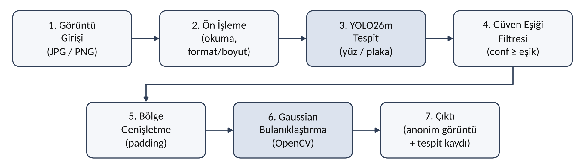

# Görüntülerde Yüz ve Plaka Bilgilerini Otomatik Bulanıklaştırma Sistemi

Fırat Üniversitesi Bilgisayar Mühendisliği Tasarım dersi (2026–2027) kapsamında geliştirdiğimiz takım projesi. **Ekip 44**

## Proje hakkında

Sistem, verilen bir görüntüdeki insan yüzlerini ve araç plakalarını önceden eğitilmiş bir YOLO26 modeliyle tespit ediyor ve bu bölgeleri OpenCV ile bulanıklaştırıyor. Görüntünün geri kalanı değiştirilmiyor.



## Ekip

- Ceren KILIÇ
- Sena KILIÇOĞLU
- Ezgi GÖZÜTOK

## Haftalık durum

| Hafta | Proje lideri | Yapılanlar |
|---|---|---|
| 1 | Ceren KILIÇ | Problem tanımı, yöntem seçimi, iş paketleri |
| 2 | Ezgi GÖZÜTOK | Gereksinim analizi, işlem akışı, test senaryoları |
| 3 | Sena KILIÇOĞLU | Test görüntüleri, ön işleme, model kurulumu |

Haftalık raporlar `docs/raporlar/` klasöründe.

## Klasör yapısı

```
├── docs/
│   ├── raporlar/     haftalık raporlar ve gereksinim analizi
│   └── sekiller/     şekiller ve diyagramlar
├── src/              kaynak kodlar
├── data/             test görüntüleri (depoya yüklenmiyor)
└── requirements.txt  kullanılan kütüphaneler
```

## Kurulum

Kod henüz eklenmedi. Kullanılacak kütüphaneler:

```bash
pip install -r requirements.txt
```

## Veri ve gizlilik

Test görüntüleri yüz ve plaka gibi kişisel veriler içerdiği için bu depoya yüklenmiyor (6698 sayılı KVKK). `data/` klasörü yalnızca yerel çalışma için kullanılıyor.
