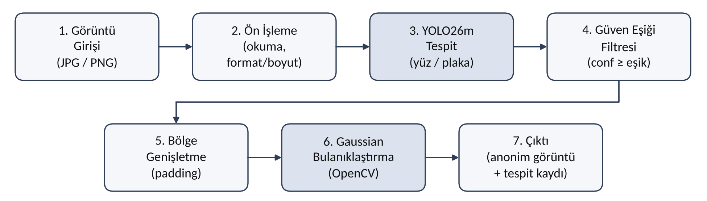

# Görüntülerde Yüz ve Plaka Bilgilerini Otomatik Bulanıklaştırma Sistemi

Fırat Üniversitesi Bilgisayar Mühendisliği Tasarım dersi (2026–2027) kapsamında geliştirdiğimiz takım projesi. **Ekip 44**

## Proje hakkında

Sistem, verilen bir görüntüdeki insan yüzlerini ve araç plakalarını önceden eğitilmiş bir YOLO26 modeliyle tespit ediyor ve bu bölgeleri OpenCV ile bulanıklaştırıyor. Görüntünün geri kalanı değiştirilmiyor.



## Ekip

- Ceren KILIÇ
- Sena KILIÇOĞLU
- Ezgi GÖZÜTOK

## Haftalık durum

| Hafta | Proje lideri | Yapılanlar |
|---|---|---|
| 1 | Ceren KILIÇ | Problem tanımı, yöntem seçimi, iş paketleri |
| 2 | Ezgi GÖZÜTOK | Gereksinim analizi, işlem akışı, test senaryoları |
| 3 | Sena KILIÇOĞLU | Test görüntüleri, ön işleme, model kurulumu |
| 4 | Ceren KILIÇ | Veri setleri (PP4AV, WIDER FACE), 320 görüntülük test seti, model kurulumu |
| 5 | Ezgi GÖZÜTOK | Toplu tespit, parçalı tespit, precision/recall ve eşik seçimi, hata analizi, bulanıklaştırma, uçtan uca prototip |

Haftalık raporlar `docs/raporlar/` klasöründe.

## Klasör yapısı

```
├── docs/
│   ├── raporlar/     haftalık raporlar ve gereksinim analizi
│   ├── sonuclar/     değerlendirme tabloları ve grafikleri (degerlendir.py üretir)
│   └── sekiller/     şekiller ve diyagramlar
├── src/              kaynak kodlar (ayrıntı: src/README.md)
├── tests/            birim testleri
├── data/             test görüntüleri (depoya yüklenmiyor)
└── requirements.txt  kullanılan kütüphaneler
```

## Kurulum

```bash
pip install -r requirements.txt

# Model (YOLO26m Face & License-Plate v3.0.0, ~130 MB, depoya yüklenmiyor)
mkdir -p models
curl -L -o models/yolo26m_face_lp.pt \
  https://github.com/H-Held/yolo26-license-plate-face-detection/releases/download/v3.0.0/yolo26m_face_lp.pt
```

## Çalıştırma

```bash
# 1) Test verisi (bir kez)
python src/veri_indir.py
python src/veri_hazirla.py

# 2) Modeli test setinde çalıştır (tam + parçalı mod). Apple M serisinde --cihaz mps daha hızlı
python src/toplu_tespit.py

# 3) Precision / recall, eşik seçimi, hata analizi -> docs/sonuclar/ozet.md
python src/degerlendir.py

# 4) Kendi fotoğrafını anonimleştir -> outputs/anonim/
python src/anonimlestir.py foto.jpg --kutular

# Testler (model ve veri gerektirmez)
python -m pytest -q tests
```

S7 (Türk plakası) için fotoğrafları `data/turk_plaka/` içine koyup `python src/etiketle.py`, ardından
`python src/etiketle.py --test-setine-ekle` çalıştırın; sonraki toplu tespit S7'yi de içerir.

## Veri ve gizlilik

Test görüntüleri yüz ve plaka gibi kişisel veriler içerdiği için bu depoya yüklenmiyor (6698 sayılı KVKK). `data/` klasörü yalnızca yerel çalışma için kullanılıyor.
