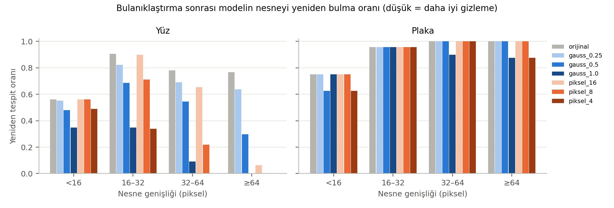

# Bulanıklaştırma yöntemlerinin karşılaştırılması

70 görüntüdeki 913 yüz ve 59 plaka, gerçek etiket kutuları kullanılarak bulanıklaştırılmış ve model (parcali mod, eşik 0.10) bulanık görüntüde tekrar çalıştırılmıştır. Yeniden tespit oranı ne kadar düşükse anonimleştirme o kadar güçlüdür.

| Yöntem | Açıklama | Yüz yeniden tespit % | Plaka yeniden tespit % |
|---|---|---|---|
| orijinal | Bulanıklaştırma yok (karşılaştırma için) | 63,0 | 94,9 |
| gauss_0.25 | Gaussian, çekirdek = kenar × 0,25 | 59,9 | 94,9 |
| gauss_0.5 | Gaussian, çekirdek = kenar × 0,5 (5. haftanın ayarı) | 50,2 | 93,2 |
| gauss_1.0 | Gaussian, çekirdek = kenar × 1,0 (6. haftadan itibaren varsayılan) | 31,4 | 89,8 |
| piksel_16 | Pikselleştirme, uzun kenarda 16 blok | 58,4 | 94,9 |
| piksel_8 | Pikselleştirme, uzun kenarda 8 blok | 53,0 | 94,9 |
| piksel_4 | Pikselleştirme, uzun kenarda 4 blok | 41,5 | 91,5 |

Boyut gruplarına göre yeniden tespit oranı:

| Yöntem | Sınıf | Genişlik (px) | Nesne | Yeniden tespit % |
|---|---|---|---|---|
| orijinal | Yüz | <16 | 693 | 56,1 |
| orijinal | Yüz | 16–32 | 118 | 90,7 |
| orijinal | Yüz | 32–64 | 55 | 78,2 |
| orijinal | Yüz | ≥64 | 47 | 76,6 |
| orijinal | Plaka | <16 | 8 | 75,0 |
| orijinal | Plaka | 16–32 | 23 | 95,7 |
| orijinal | Plaka | 32–64 | 20 | 100,0 |
| orijinal | Plaka | ≥64 | 8 | 100,0 |
| gauss_0.25 | Yüz | <16 | 693 | 55,1 |
| gauss_0.25 | Yüz | 16–32 | 118 | 82,2 |
| gauss_0.25 | Yüz | 32–64 | 55 | 69,1 |
| gauss_0.25 | Yüz | ≥64 | 47 | 63,8 |
| gauss_0.25 | Plaka | <16 | 8 | 75,0 |
| gauss_0.25 | Plaka | 16–32 | 23 | 95,7 |
| gauss_0.25 | Plaka | 32–64 | 20 | 100,0 |
| gauss_0.25 | Plaka | ≥64 | 8 | 100,0 |
| gauss_0.5 | Yüz | <16 | 693 | 48,1 |
| gauss_0.5 | Yüz | 16–32 | 118 | 68,6 |
| gauss_0.5 | Yüz | 32–64 | 55 | 54,5 |
| gauss_0.5 | Yüz | ≥64 | 47 | 29,8 |
| gauss_0.5 | Plaka | <16 | 8 | 62,5 |
| gauss_0.5 | Plaka | 16–32 | 23 | 95,7 |
| gauss_0.5 | Plaka | 32–64 | 20 | 100,0 |
| gauss_0.5 | Plaka | ≥64 | 8 | 100,0 |
| gauss_1.0 | Yüz | <16 | 693 | 34,8 |
| gauss_1.0 | Yüz | 16–32 | 118 | 34,7 |
| gauss_1.0 | Yüz | 32–64 | 55 | 9,1 |
| gauss_1.0 | Yüz | ≥64 | 47 | 0,0 |
| gauss_1.0 | Plaka | <16 | 8 | 75,0 |
| gauss_1.0 | Plaka | 16–32 | 23 | 95,7 |
| gauss_1.0 | Plaka | 32–64 | 20 | 90,0 |
| gauss_1.0 | Plaka | ≥64 | 8 | 87,5 |
| piksel_16 | Yüz | <16 | 693 | 56,0 |
| piksel_16 | Yüz | 16–32 | 118 | 89,8 |
| piksel_16 | Yüz | 32–64 | 55 | 65,5 |
| piksel_16 | Yüz | ≥64 | 47 | 6,4 |
| piksel_16 | Plaka | <16 | 8 | 75,0 |
| piksel_16 | Plaka | 16–32 | 23 | 95,7 |
| piksel_16 | Plaka | 32–64 | 20 | 100,0 |
| piksel_16 | Plaka | ≥64 | 8 | 100,0 |
| piksel_8 | Yüz | <16 | 693 | 56,0 |
| piksel_8 | Yüz | 16–32 | 118 | 71,2 |
| piksel_8 | Yüz | 32–64 | 55 | 21,8 |
| piksel_8 | Yüz | ≥64 | 47 | 0,0 |
| piksel_8 | Plaka | <16 | 8 | 75,0 |
| piksel_8 | Plaka | 16–32 | 23 | 95,7 |
| piksel_8 | Plaka | 32–64 | 20 | 100,0 |
| piksel_8 | Plaka | ≥64 | 8 | 100,0 |
| piksel_4 | Yüz | <16 | 693 | 48,9 |
| piksel_4 | Yüz | 16–32 | 118 | 33,9 |
| piksel_4 | Yüz | 32–64 | 55 | 0,0 |
| piksel_4 | Yüz | ≥64 | 47 | 0,0 |
| piksel_4 | Plaka | <16 | 8 | 62,5 |
| piksel_4 | Plaka | 16–32 | 23 | 95,7 |
| piksel_4 | Plaka | 32–64 | 20 | 100,0 |
| piksel_4 | Plaka | ≥64 | 8 | 87,5 |

Not: 'Orijinal' satırı, bulanıklaştırmadan önce modelin aynı nesneleri bulma oranıdır (karşılaştırma tabanı). Yeniden tespit, tanınabilirliğin doğrudan ölçüsü değil dolaylı bir göstergesidir; görsel kontrol için outputs/bulanik_karsilastirma/ornekler.jpg dosyasına bakınız.
