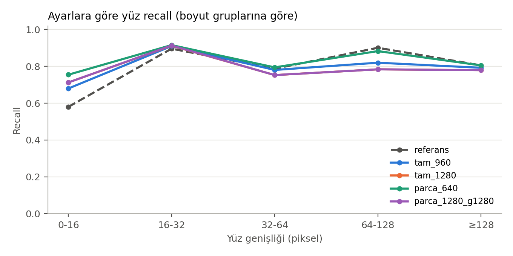

# Küçük yüzler için iyileştirme denemesi

Test seti: 320 görüntü. Tüm ayarlarda aynı eşik kullanılmıştır (Yüz 0.10, Plaka 0.10).

| Ayar | Açıklama | Yüz P | Yüz R | Yüz F2 | Yüz FP | R (<16 px) | R (16–32 px) | Plaka P | Plaka R | Sızıntısız % | ms/görüntü |
|---|---|---|---|---|---|---|---|---|---|---|---|
| referans | 5. hafta: parça 1280, giriş 640 | 0,594 | 0,688 | 0,667 | 1758 | 0,580 | 0,896 | 0,804 | 0,905 | 59,6 | 115 |
| tam_960 | Tam görüntü, giriş 960 | 0,628 | 0,751 | 0,722 | 1668 | 0,680 | 0,910 | 0,760 | 0,941 | 60,0 | 195 |
| tam_1280 | Tam görüntü, giriş 1280 | 0,631 | 0,768 | 0,736 | 1680 | 0,713 | 0,912 | 0,749 | 0,957 | 61,8 | 346 |
| parca_640 | Parça 640, giriş 640 | 0,572 | 0,802 | 0,742 | 2252 | 0,755 | 0,915 | 0,714 | 0,957 | 63,9 | 639 |
| parca_1280_g1280 | Parça 1280, giriş 1280 | 0,631 | 0,769 | 0,736 | 1685 | 0,713 | 0,913 | 0,747 | 0,957 | 61,8 | 448 |

Her ayar için ayrıca F2'yi en yüksek yapan yüz eşiği:

| Ayar | Yüz eşiği | Yüz R | Yüz F2 |
|---|---|---|---|
| referans | 0,10 | 0,688 | 0,667 |
| tam_960 | 0,15 | 0,729 | 0,727 |
| tam_1280 | 0,15 | 0,749 | 0,744 |
| parca_640 | 0,20 | 0,771 | 0,757 |
| parca_1280_g1280 | 0,15 | 0,750 | 0,744 |

## Otomatik gözlemler (rapora yazmadan önce kontrol edin)

- tam_960: yüz recall 0,688 → 0,751, <16 px recall 0,580 → 0,680, yüz FP 1758 → 1668, süre 115 → 195 ms.

- tam_1280: yüz recall 0,688 → 0,768, <16 px recall 0,580 → 0,713, yüz FP 1758 → 1680, süre 115 → 346 ms.

- parca_640: yüz recall 0,688 → 0,802, <16 px recall 0,580 → 0,755, yüz FP 1758 → 2252, süre 115 → 639 ms.

- parca_1280_g1280: yüz recall 0,688 → 0,769, <16 px recall 0,580 → 0,713, yüz FP 1758 → 1685, süre 115 → 448 ms.

- Yüz F2'ye göre en iyi ayar: **parca_640** (0,742).
