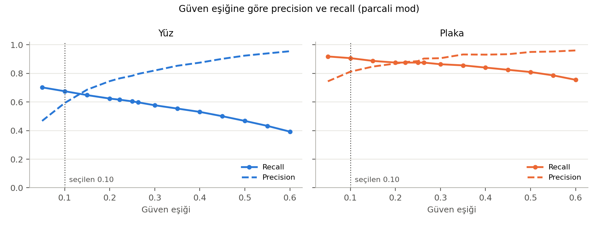
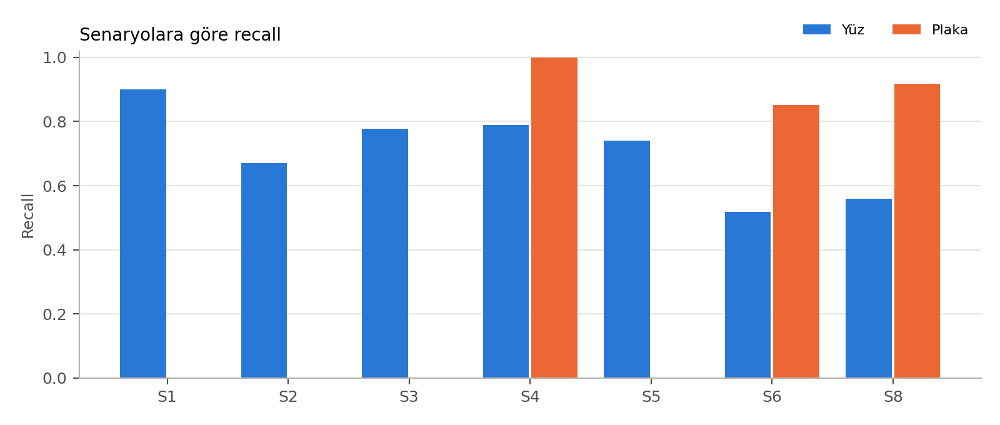
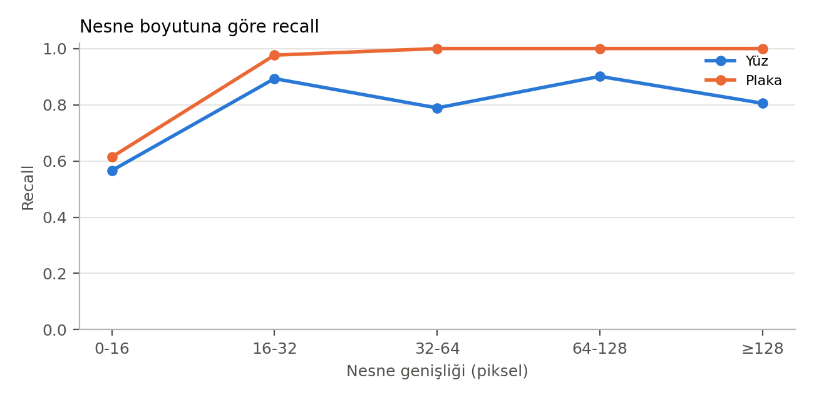

# 5. Hafta Değerlendirme Sonuçları

Test seti: 320 görüntü. Eşleştirme ölçütü: IoU ≥ 0.5. Eşik seçimi: her sınıf için F2 skorunu en yüksek yapan eşik.

## 1. Tespit modu ve eşik karşılaştırması

| Mod | Eşik | Sınıf | Eşik değeri | Precision | Recall | F2 | Sızıntısız görüntü % | ms/görüntü |
|---|---|---|---|---|---|---|---|---|
| tam | model kartı | Yüz | 0,222 | 0,764 | 0,614 | 0,639 | 50,4 | 25 |
| tam | model kartı | Plaka | 0,263 | 0,913 | 0,860 | 0,870 | 50,4 | 25 |
| tam | F2 ile seçilen | Yüz | 0,1 | 0,591 | 0,674 | 0,655 | 52,9 | 25 |
| tam | F2 ile seçilen | Plaka | 0,1 | 0,826 | 0,887 | 0,874 | 52,9 | 25 |
| parcali | model kartı | Yüz | 0,222 | 0,765 | 0,616 | 0,641 | 51,1 | 35 |
| parcali | model kartı | Plaka | 0,263 | 0,904 | 0,875 | 0,881 | 51,1 | 35 |
| parcali | F2 ile seçilen | Yüz | 0,1 | 0,592 | 0,675 | 0,657 | 53,9 | 35 |
| parcali | F2 ile seçilen | Plaka | 0,1 | 0,812 | 0,907 | 0,886 | 53,9 | 35 |

**Seçilen mod: parcali** (ortalama F2 = 0.771). Seçilen eşikler: yüz = 0.10, plaka = 0.10.

## 2. Eşik taraması

| Eşik | Sınıf | TP | FP | FN | Precision | Recall | F2 |
|---|---|---|---|---|---|---|---|
| 0,05 | Yüz | 2650 | 3018 | 1125 | 0,468 | 0,702 | 0,638 |
| 0,1 | Yüz | 2549 | 1754 | 1226 | 0,592 | 0,675 | 0,657 |
| 0,15 | Yüz | 2446 | 1119 | 1329 | 0,686 | 0,648 | 0,655 |
| 0,2 | Yüz | 2355 | 804 | 1420 | 0,745 | 0,624 | 0,645 |
| 0,222 | Yüz | 2325 | 714 | 1450 | 0,765 | 0,616 | 0,641 |
| 0,25 | Yüz | 2281 | 631 | 1494 | 0,783 | 0,604 | 0,633 |
| 0,263 | Yüz | 2255 | 577 | 1520 | 0,796 | 0,597 | 0,629 |
| 0,3 | Yüz | 2178 | 478 | 1597 | 0,820 | 0,577 | 0,613 |
| 0,35 | Yüz | 2091 | 360 | 1684 | 0,853 | 0,554 | 0,596 |
| 0,4 | Yüz | 2003 | 286 | 1772 | 0,875 | 0,531 | 0,576 |
| 0,45 | Yüz | 1889 | 206 | 1886 | 0,902 | 0,500 | 0,549 |
| 0,5 | Yüz | 1765 | 145 | 2010 | 0,924 | 0,468 | 0,519 |
| 0,55 | Yüz | 1633 | 105 | 2142 | 0,940 | 0,433 | 0,485 |
| 0,6 | Yüz | 1482 | 70 | 2293 | 0,955 | 0,393 | 0,445 |
| 0,05 | Plaka | 236 | 81 | 21 | 0,744 | 0,918 | 0,877 |
| 0,1 | Plaka | 233 | 54 | 24 | 0,812 | 0,907 | 0,886 |
| 0,15 | Plaka | 228 | 41 | 29 | 0,848 | 0,887 | 0,879 |
| 0,2 | Plaka | 225 | 34 | 32 | 0,869 | 0,875 | 0,874 |
| 0,222 | Plaka | 225 | 31 | 32 | 0,879 | 0,875 | 0,876 |
| 0,25 | Plaka | 225 | 29 | 32 | 0,886 | 0,875 | 0,878 |
| 0,263 | Plaka | 225 | 24 | 32 | 0,904 | 0,875 | 0,881 |
| 0,3 | Plaka | 222 | 23 | 35 | 0,906 | 0,864 | 0,872 |
| 0,35 | Plaka | 220 | 16 | 37 | 0,932 | 0,856 | 0,870 |
| 0,4 | Plaka | 216 | 16 | 41 | 0,931 | 0,840 | 0,857 |
| 0,45 | Plaka | 212 | 15 | 45 | 0,934 | 0,825 | 0,845 |
| 0,5 | Plaka | 208 | 11 | 49 | 0,950 | 0,809 | 0,834 |
| 0,55 | Plaka | 202 | 10 | 55 | 0,953 | 0,786 | 0,815 |
| 0,6 | Plaka | 194 | 8 | 63 | 0,960 | 0,755 | 0,789 |

## 3. Senaryo bazında sonuçlar (parcali mod, seçilen eşikler)

| Senaryo | Açıklama | Sınıf | Gerçek nesne | TP | FP | FN | Precision | Recall | Sızıntısız görüntü % | FP / görüntü |
|---|---|---|---|---|---|---|---|---|---|---|
| S1 | Yakın plan, tek kişi | Yüz | 40 | 36 | 21 | 4 | 0,632 | 0,900 | 90,0 | 0,53 |
| S2 | Kalabalık, küçük yüzler | Yüz | 3190 | 2135 | 1596 | 1055 | 0,572 | 0,669 | 2,5 | 39,90 |
| S3 | Profil / eğik açı | Yüz | 180 | 140 | 48 | 40 | 0,745 | 0,778 | 47,5 | 1,20 |
| S4 | Gece / düşük ışık | Yüz | 19 | 15 | 2 | 4 | 0,882 | 0,789 | 60,0 | 0,05 |
| S4 | Gece / düşük ışık | Plaka | 40 | 40 | 0 | 0 | 1,000 | 1,000 | 100,0 | 0,00 |
| S5 | Kısmen kapanmış yüz | Yüz | 174 | 129 | 44 | 45 | 0,746 | 0,741 | 45,0 | 1,10 |
| S6 | Uzaktaki / eğik plaka | Yüz | 54 | 28 | 12 | 26 | 0,700 | 0,519 | 36,8 | 0,30 |
| S6 | Uzaktaki / eğik plaka | Plaka | 95 | 81 | 13 | 14 | 0,862 | 0,853 | 72,5 | 0,33 |
| S8 | Yüz ve plaka birlikte | Yüz | 118 | 66 | 27 | 52 | 0,710 | 0,559 | 42,5 | 0,68 |
| S8 | Yüz ve plaka birlikte | Plaka | 122 | 112 | 10 | 10 | 0,918 | 0,918 | 77,5 | 0,25 |
| S9 | Yüz veya plaka yok | Yüz | 0 | 0 | 4 | 0 | 0,000 | – | – | 0,10 |
| S9 | Yüz veya plaka yok | Plaka | 0 | 0 | 31 | 0 | 0,000 | – | – | 0,78 |

Not: WIDER FACE görüntülerinde (S1-S5) plakalar etiketli olmadığı için yalnızca yüz değerlendirilmiştir. S9'da gerçek nesne olmadığından yalnızca FP sayısı anlamlıdır.

## 4. Nesne boyutuna göre recall (hata analizi)

| Sınıf | Genişlik (px) | Nesne sayısı | Recall |
|---|---|---|---|
| Yüz | 0-16 | 2405 | 0,566 |
| Yüz | 16-32 | 898 | 0,893 |
| Yüz | 32-64 | 284 | 0,789 |
| Yüz | 64-128 | 111 | 0,901 |
| Yüz | ≥128 | 77 | 0,805 |
| Plaka | 0-16 | 57 | 0,614 |
| Plaka | 16-32 | 85 | 0,976 |
| Plaka | 32-64 | 89 | 1,000 |
| Plaka | 64-128 | 17 | 1,000 |
| Plaka | ≥128 | 9 | 1,000 |

## 5. Otomatik gözlemler

- Yüz: en düşük recall S6 (Uzaktaki / eğik plaka, 0,519), en yüksek S1 (0,900).

- Yüz: en küçük boyut grubunda (0-16 px) recall 0,566, en büyük grupta (≥128 px) 0,805.

- Plaka: en düşük recall S6 (Uzaktaki / eğik plaka, 0,853), en yüksek S4 (1,000).

- Plaka: en küçük boyut grubunda (0-16 px) recall 0,614, en büyük grupta (≥128 px) 1,000.

- Yüz: parçalı mod recall'u 0,674 → 0,675 olarak değiştirdi (tam → parçalı).

- Plaka: parçalı mod recall'u 0,887 → 0,907 olarak değiştirdi (tam → parçalı).

- Süre: tam 25 ms, parçalı 35 ms / görüntü.
